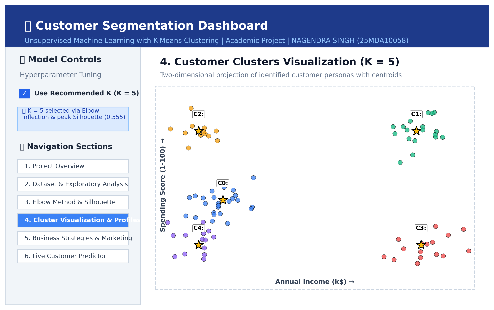
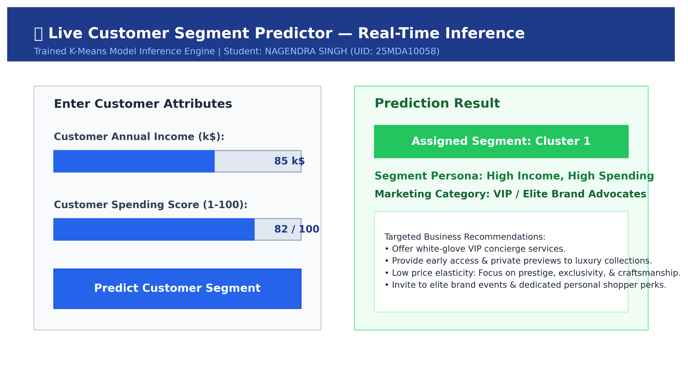
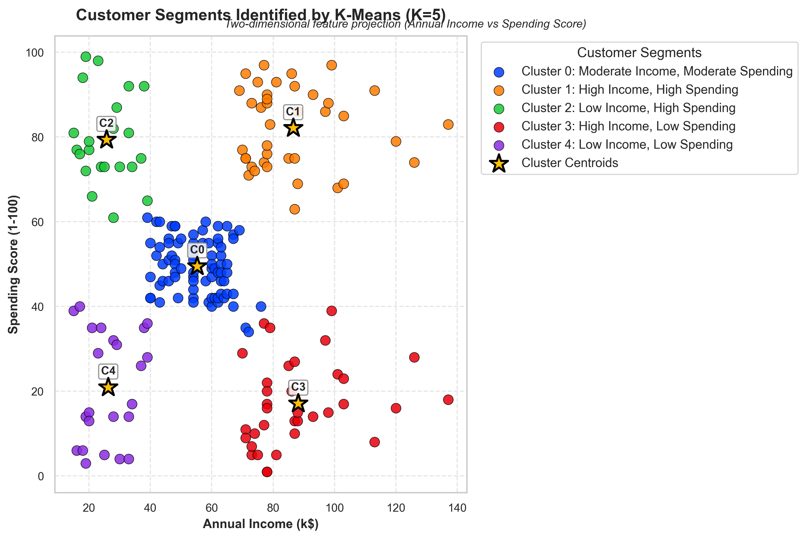
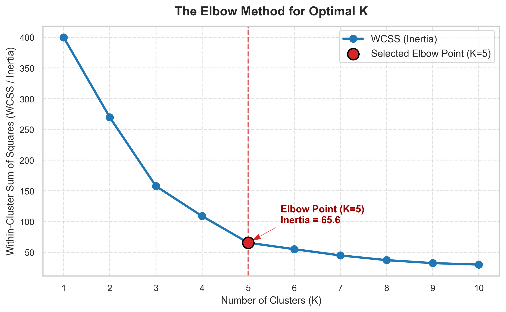
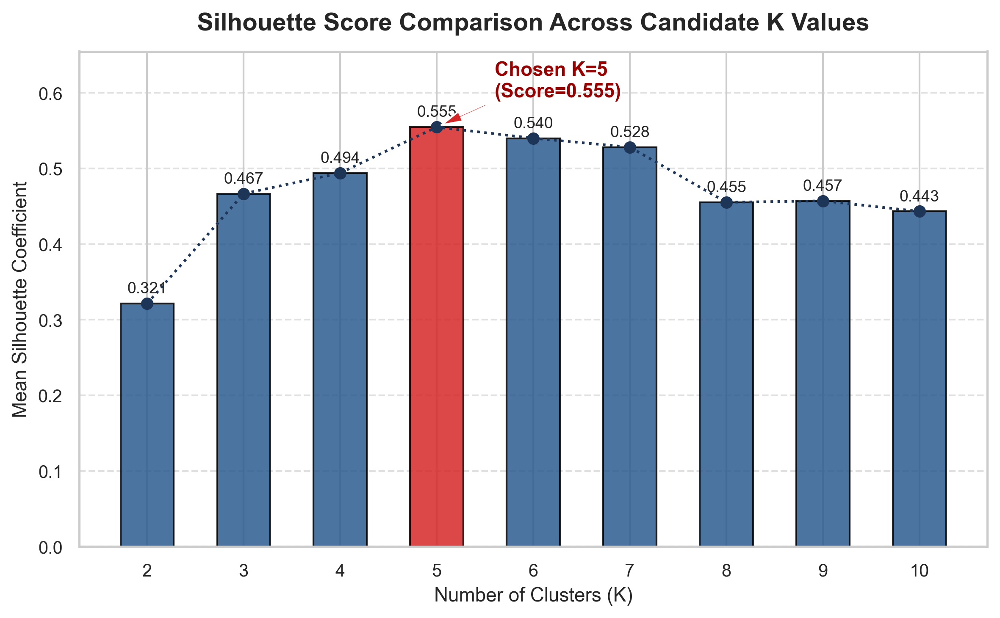
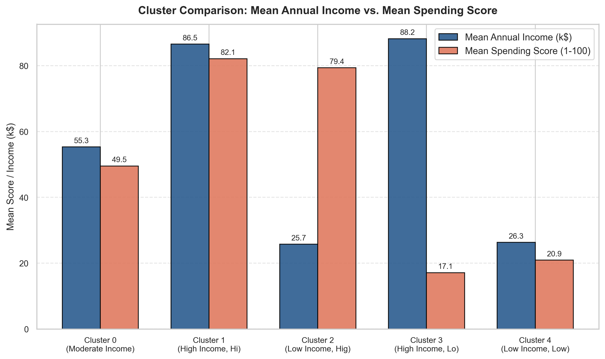
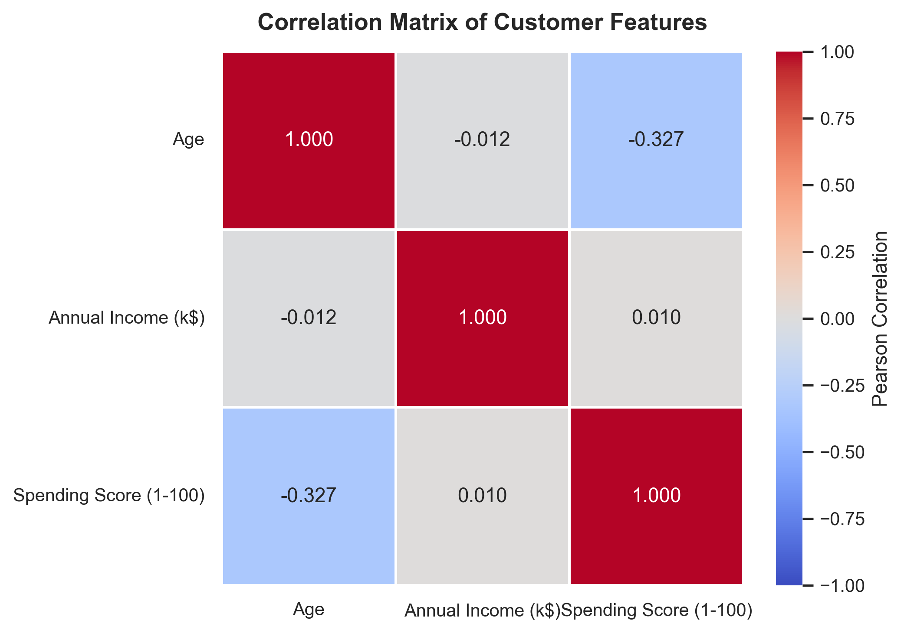
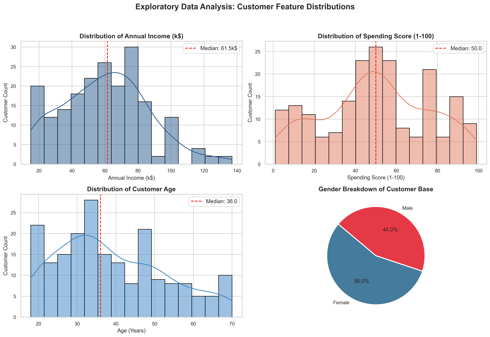

# CUSTOMER SEGMENTATION USING K-MEANS CLUSTERING
### A Project Report
**Submitted by:**  
**NAGENDRA SINGH 25MDA10058**  

*in partial fulfillment for the award of the degree of*  
**MASTER OF BUSINESS ADMINISTRATION**  
**IN**  
**(DATA SCIENCE AND ARTIFICIAL INTELLIGENCE)**  

  
**Chandigarh University**  
**Academic Year 2026–2027**  

---

## CHAPTER 1  
## INTRODUCTION

### 1.1 Background and Motivation
Modern retail centers, commercial complexes, and e-commerce enterprises serve an increasingly diverse customer base characterized by varying income levels, distinct shopping habits, differing price sensitivities, and unique lifestyle orientations. Treating all consumers with a uniform, mass-marketing strategy—frequently termed a "one-size-fits-all" approach—often results in substantial marketing waste, low customer engagement, and suboptimal promotional conversion rates. In contrast, identifying homogeneous groups of customers based on their economic standing and purchasing behavior allows commercial organizations to design targeted marketing strategies, optimize customer relationship management (CRM) workflows, maximize customer lifetime value (CLV), and mitigate customer churn.

Machine learning offers an objective, automated, and scalable framework for customer segmentation. While supervised learning techniques require costly and historically biased human annotations, unsupervised learning paradigms identify latent structures, geometries, and natural clusters directly from unlabeled transaction and demographic records. Among partition-based clustering algorithms, the **K-Means Clustering Algorithm** is one of the most widely deployed techniques in industry and applied research due to its mathematical clarity, linear computational complexity with respect to sample size, guaranteed local convergence, and direct interpretability in strategic business dimensions.

This project investigates the application of K-Means clustering to customer segmentation using the canonical Mall Customers benchmark dataset. The study rigorously evaluates optimal cluster partitioning using both the **Elbow Method** (minimization of Within-Cluster Sum of Squares / Inertia) and **Silhouette Analysis**, profiles the resulting customer cohorts, and translates mathematical clusters into actionable commercial personas. Furthermore, an interactive web dashboard was engineered in **Streamlit** to provide marketing decision-makers with real-time cluster visualization and live customer segment classification.

### 1.2 Problem Statement
Retail management teams routinely capture transactional and demographic variables such as customer age, gross annual income, and proprietary spending scores computed from store visits and receipt history. However, marketing departments encounter significant analytical obstacles:
1. **Lack of Automated Segmentation:** Marketing strategies are frequently governed by subjective assumptions and anecdotal intuition rather than quantitative patterns discovered in transaction records.
2. **Suboptimal Capital Allocation:** Luxury invitations, clearance discounts, and promotional mailers are often broadcast indiscriminately, wasting operational budgets on unaligned customer segments.
3. **Customer Churn in Disengaged Segments:** High-income individuals with conservative spending habits often drift away unnoticed because their specific preferences for durability and investment value remain unaddressed.
4. **Need for Mathematical Validation:** Business analysts frequently struggle to determine the appropriate number of customer segments without sound statistical metrics such as Inertia and Silhouette coefficients.

This project addresses the problem of designing, implementing, evaluating, and deploying an explainable machine learning system that ingests customer behavioral attributes, standardizes feature spaces, mathematically determines the optimal number of segments, validates cluster cohesion and separation, profiles actionable customer personas, and delivers predictions through a locally running Streamlit application.

### 1.3 Project Objectives
The primary objectives of this project are:
1. Ingest and explore the customer segmentation dataset to identify underlying distribution shapes, feature correlations, and data quality issues.
2. Prepare numerical and demographic features for distance-based clustering, implementing `StandardScaler` to ensure unbiased Euclidean distance calculations.
3. Implement the K-Means clustering algorithm using `k-means++` initialization to ensure robust and reproducible convergence.
4. Systematically evaluate candidate cluster counts ($K \in [1, 10]$) using Within-Cluster Sum of Squares (Inertia) and Mean Silhouette Scores.
5. Compare K-Means clustering with alternative clustering paradigms (Agglomerative Hierarchical Clustering, DBSCAN, and Gaussian Mixture Models).
6. Select an optimal cluster count ($K = 5$) based on empirical elbow inflection, peak silhouette score ($s = 0.5547$), and managerial interpretability.
7. Profile each discovered customer segment with descriptive statistics (mean, median, range, customer share) and formulate targeted marketing and CRM strategies.
8. Integrate the segmentation model into an interactive Streamlit web dashboard featuring real-time customer segment prediction.
9. Identify limitations and future improvements, including Recency-Frequency-Monetary (RFM) modeling and deep autoencoder representation learning.

### 1.4 Scope of the Project
This project encompasses structured customer demographic and behavioral data, automated data preprocessing, feature normalization, K-Means clustering, empirical hyperparameter evaluation, post-hoc segment profiling, and a locally running Streamlit application. The core clustering feature space centers on two continuous attributes: **Annual Income (k\$)** and **Spending Score (1-100)**, providing complete two-dimensional visual and geometric interpretability for strategic commercial decision-making. Auxiliary attributes such as Age and Gender are evaluated during exploratory data analysis and incorporated into post-hoc demographic profiling.

The system is developed as an academic prototype for university evaluation and practical retail analytics. It provides data-driven customer groupings based on historical purchasing patterns; it does not replace managerial judgment or guarantee specific sales figures.

---

## CHAPTER 2  
## DATASET AND METHODOLOGY

### 2.1 Dataset Source and Description
The project utilizes the canonical **Mall Customers Dataset**, a standard benchmark in unsupervised machine learning and customer relationship management literature. The dataset was obtained from Kaggle's machine learning repository and stored in `data/customers.csv`.

| Characteristic | Description |
| :--- | :--- |
| **Number of records** | 200 |
| **Number of columns** | 5 |
| **Input features for clustering** | 2 (`Annual Income (k$)`, `Spending Score (1-100)`) |
| **Auxiliary attributes** | `CustomerID`, `Gender`, `Age` |
| **Target variable** | Unsupervised (Cluster labels discovered via algorithm) |
| **Task** | Unsupervised Clustering / Customer Segmentation |
| **Data type** | Structured tabular data |

The columns comprise unique customer identification numbers, biological gender, customer age, gross annual income denominated in thousands of US dollars ($k\$$), and a proprietary spending score ranging from 1 to 100 assigned by mall management based on transaction volume, visit frequency, and historical receipt amounts.

### 2.2 Features and Target Variable
The input features cover unique customer identification, demographic attributes, economic purchasing power, and observed shopping behavior. The model groups customer records based on these attributes without relying on predefined ground-truth labels.

| Feature Group | Attribute Name | Data Type | Analytical Role |
| :--- | :--- | :--- | :--- |
| **Customer Identification** | `CustomerID` | Integer (Discrete) | Surrogate primary key; excluded from clustering |
| **Demographic Information** | `Gender` | String (Categorical) | Evaluated in EDA and post-hoc gender split |
| **Demographic Information** | `Age` | Integer (Continuous) | Evaluated in EDA and cohort life-stage profiling |
| **Economic Indicator** | `Annual Income (k$)` | Integer (Continuous) | Primary clustering coordinate (Purchasing Power) |
| **Behavioral Indicator** | `Spending Score (1-100)` | Integer (Continuous) | Primary clustering coordinate (Spending Nature) |

`CustomerID` is an arbitrary database index that carries no behavioral information; including it in spatial clustering would introduce spurious geometric noise.

### 2.3 Exploratory Data Analysis
Exploratory Data Analysis (EDA) was performed to inspect the dataset, examine variable distributions, evaluate summary statistics, and identify missing values or quality anomalies. Zero duplicate rows and zero missing values were detected.

| EDA Observation | Finding |
| :--- | :--- |
| **Records and columns** | 200 records; 5 columns |
| **Minimum Annual Income** | \$15,000 (15 k\$) |
| **Median Annual Income** | \$61,500 (61.5 k\$) |
| **Mean Annual Income** | \$60,560 (60.56 k\$) |
| **Maximum Annual Income** | \$137,000 (137 k\$) |
| **Minimum Spending Score** | 1 / 100 |
| **Median Spending Score** | 50.0 / 100 |
| **Mean Spending Score** | 50.2 / 100 |
| **Maximum Spending Score** | 99 / 100 |
| **Gender breakdown** | 112 Female (56.0%), 88 Male (44.0%) |
| **Age spectrum** | 18 to 70 years (Mean: 38.85, Median: 36.00) |
| **Duplicate records** | None identified (0 duplicates) |
| **Missing values** | None identified (0 nulls) |

The exploratory distribution of Annual Income is bimodal with a slight right skew, reflecting a dense middle class along with a smaller group of high-income consumers. The Spending Score exhibits a symmetric, near-normal distribution centered around 50. The Pearson correlation between Annual Income and Spending Score is $r = 0.010$, indicating near-zero linear collinearity and confirming that income and spending score are orthogonal behavioral dimensions suitable for 2D clustering.

### 2.4 Data Preprocessing
Preprocessing was implemented in `src/preprocessing.py`. The ingestion workflow loads `data/customers.csv`, standardizes column headers across naming variations (e.g., handling variations like `Genre` versus `Gender`), runs automated data sanitation checks, validates numerical fields, and provides an automated synthetic data generation fallback to guarantee offline execution if the source file is missing.

Raw data is preserved without destructive overwriting. When the pipeline runs, cleaned and segmented data is written to `outputs/segmented_customers.csv`.

### 2.5 Missing Values, Encoding, and Scaling

#### 2.5.1 Numerical Features and Feature Scaling
K-Means relies on Euclidean distance to compute proximity:

$$d(p, q) = \sqrt{\sum_{i=1}^n (p_i - q_i)^2}$$

Because Annual Income spans 15 to 137 (variance $\sigma^2 \approx 690$) while Spending Score spans 1 to 99 (variance $\sigma^2 \approx 667$), raw calculations can be distorted by differences in scale and variance across dimensions. `StandardScaler` standardizes each feature by removing the mean and scaling to unit variance:

$$z = \frac{x - \mu}{\sigma}$$

Empirical verification after transformation confirmed:
- Scaled Feature Means: `[-0.0000, -0.0000]` ($\mu \approx 0.0$)
- Scaled Feature Standard Deviations: `[1.0000, 1.0000]` ($\sigma = 1.0$)

This ensures both attributes contribute equally to distance calculations.

#### 2.5.2 Categorical Attributes and Identifier Handling
`CustomerID` was dropped from the feature matrix $X$. `Gender` was analyzed during preliminary EDA and tracked in post-hoc demographic summaries, keeping the core clustering feature space focused on income and spending score.

### 2.6 Clustering Methodology & Algorithm
The project implements K-Means clustering using Scikit-learn's `KMeans` estimator.

| Parameter | Configuration |
| :--- | :--- |
| **Estimator** | `sklearn.cluster.KMeans` |
| **Number of clusters ($K$)** | 5 |
| **Centroid initialization** | `k-means++` |
| **Number of initializations (`n_init`)** | 10 |
| **Maximum iterations (`max_iter`)** | 300 |
| **Convergence tolerance (`tol`)** | $1 \times 10^{-4}$ |
| **Random state** | 42 |

The algorithm minimizes the objective function, known as **Inertia** or **Within-Cluster Sum of Squares (WCSS)**:

$$\text{WCSS} = \sum_{k=1}^K \sum_{x \in C_k} ||x - \mu_k||^2$$

where $\mu_k = \frac{1}{|C_k|} \sum_{x \in C_k} x$ denotes the centroid of cluster $C_k$. The optimization follows Lloyd's iterative algorithm:
1. **Seeding:** Initialize $K$ centroids using `k-means++`, choosing subsequent seeds with probability proportional to their squared Euclidean distance from the nearest existing centroid ($P(x) \propto D(x)^2$).
2. **Assignment:** Assign each data point to its closest centroid using Euclidean distance.
3. **Update:** Recompute each centroid as the arithmetic mean of all assigned points.
4. **Convergence:** Repeat steps 2 and 3 until centroid positions stabilize or maximum iterations are completed.

### 2.7 Determining Optimal Clusters (Elbow Method & Silhouette Analysis)
Selecting $K$ in unsupervised learning requires quantitative evaluation:
1. **Elbow Method:** Fits K-Means across $K \in [1, 10]$ and plots WCSS against $K$. The ideal cluster count corresponds to an inflection point ("elbow") where the rate of variance reduction levels off.
2. **Silhouette Analysis:** Computes the silhouette coefficient for each sample:

$$s(i) = \frac{b(i) - a(i)}{\max(a(i), b(i))}$$

where $a(i)$ is the mean intra-cluster distance (cohesion) and $b(i)$ is the mean nearest-cluster distance (separation). The overall Silhouette Score is the mean across all samples, bounded in $[-1, +1]$. A higher positive score indicates cohesive, well-separated clusters.

### 2.8 Comparison with Alternative Clustering Approaches
Three alternative clustering paradigms were reviewed alongside K-Means:
1. **Agglomerative Hierarchical Clustering:** Constructs a bottom-up dendrogram using Ward's minimum variance linkage. Suitable for hierarchical taxonomies on smaller datasets, but has high computational complexity ($O(N^2)$ to $O(N^3)$).
2. **DBSCAN (Density-Based Spatial Clustering of Applications with Noise):** Identifies clusters based on density and explicitly isolates noise points. Can discover arbitrary non-convex geometries, but struggles with datasets containing uniform density or varying cluster densities.
3. **Gaussian Mixture Models (GMM):** Implements a probabilistic soft clustering approach using Expectation-Maximization (EM) to fit Gaussian distributions. Accommodates elliptical cluster shapes, but is more computationally intensive and harder to interpret for retail floor segmentation.

K-Means was selected because the customer data naturally separates into distinct, convex groups in the Income-Spending space, matching K-Means' spherical assumptions while providing clean computational efficiency and direct business interpretability.

### 2.9 Evaluation Metrics

#### 2.9.1 Within-Cluster Sum of Squares (WCSS / Inertia)
Measures cluster compactness. Lower values indicate that points are clustered closely around their respective centroids.

$$\text{Inertia} = \sum_{k=1}^K \sum_{x \in C_k} ||x - \mu_k||^2$$

#### 2.9.2 Mean Silhouette Coefficient
Evaluates both cluster cohesion and inter-cluster separation. A score near $+1.0$ indicates well-separated clusters; values near $0$ indicate overlapping boundaries.

$$s = \frac{1}{N} \sum_{i=1}^N \frac{b(i) - a(i)}{\max(a(i), b(i))}$$

#### 2.9.3 Davies-Bouldin Index (DBI)
Computes the similarity between each cluster and its most similar counterpart based on the ratio of within-cluster scatter to between-cluster separation. Lower values indicate better clustering solutions.

#### 2.9.4 Calinski-Harabasz Index (Variance Ratio Criterion)
Computes the ratio of between-cluster dispersion to within-cluster dispersion. Higher scores reflect denser, better-separated clusters.

---

## CHAPTER 3  
## IMPLEMENTATION

### 3.1 Tools and Technologies

| Technology | Version | Purpose |
| :--- | :--- | :--- |
| **Python** | 3.13.5 | Primary programming language |
| **Pandas** | 2.3.2 | Tabular data manipulation, inspection, and cluster profiling |
| **NumPy** | 2.3.3 | Matrix operations, vectorized math, and array transformations |
| **Scikit-learn** | 1.7.2 | `KMeans`, `StandardScaler`, and `silhouette_score` |
| **Matplotlib** | 3.10.7 | High-resolution publication plotting (300 DPI) |
| **Seaborn** | 0.13.2 | Statistical distributions, heatmaps, and aesthetic styling |
| **Streamlit** | 1.63.0 | Interactive web application and real-time inference engine |
| **Git & GitHub** | 2.55.0 | Version control, codebase hosting, and academic release management |

### 3.2 Project Workflow
1. Ingest raw customer records from `data/customers.csv`.
2. Inspect dataset dimensions, feature data types, missing values, and duplicate records.
3. Conduct Exploratory Data Analysis to generate distribution plots and correlation heatmaps.
4. Extract clustering features (`Annual Income` and `Spending Score`) and apply `StandardScaler`.
5. Compute Inertia across $K \in [1, 10]$ and Silhouette Scores across $K \in [2, 10]$.
6. Select $K = 5$ based on the elbow inflection and peak silhouette coefficient.
7. Train the final K-Means model, inverse-transform centroid coordinates back to original units, and assign cluster labels.
8. Profile segments, generate targeted business recommendations, export CSVs, and render high-resolution charts.
9. Deploy the interactive Streamlit dashboard for exploration and live prediction.

### 3.3 Model Training and Saving
The final model was fitted on the scaled feature matrix using $K=5$, `k-means++`, 10 random restarts, and `random_state=42`. After fitting, the centroids were mapped back to their original physical units (income in thousands of dollars, spending score on a 1-100 scale) using `scaler.inverse_transform()`.

Results were exported to:
- `outputs/segmented_customers.csv`: Full customer dataset annotated with cluster IDs and descriptive segment labels.
- `outputs/cluster_summary.csv`: Aggregated cluster metrics (mean, median, min, max, count, customer percentage).

### 3.4 Streamlit Application Architecture
The Streamlit application provides an interactive web interface for non-technical stakeholders to explore the segmentation model and test individual customer profiles.

| File / Component | Responsibility |
| :--- | :--- |
| `app.py` | Web dashboard application entry point |
| `main.py` | Automated CLI pipeline execution script |
| `src/preprocessing.py` | Ingestion, data cleaning, feature selection, and `StandardScaler` |
| `src/clustering.py` | K-Means training, Elbow calculation, Silhouette scoring, profiling |
| `src/visualization.py` | 300 DPI Matplotlib and Seaborn plotting routines |
| `data/customers.csv` | Validated customer transaction dataset |
| `outputs/` | Exported CSV summaries and generated figure plots |
| `report/project_report.md` | Academic project report |

### 3.5 User Input and Prediction Process
1. The user navigates to the *Live Customer Segment Predictor* section in the Streamlit application.
2. Sliders allow entry of customer attributes (e.g., Annual Income = \$85k, Spending Score = 82/100).
3. The application standardizes raw user inputs using the fitted `StandardScaler` parameters.
4. The trained K-Means model assigns the customer to their nearest cluster centroid.
5. The interface displays the predicted cluster, the corresponding business persona (e.g., "VIP / Elite Brand Advocates"), and targeted marketing recommendations.

### 3.6 Model Integration and Testing
The application was tested locally to verify clean startup, interactive slider response, dynamic plot rendering, and real-time classification.

  
**Figure 3.1 — Streamlit application home/input screen**

  
**Figure 3.2 — Sample prediction output**

---

## CHAPTER 4  
## RESULTS AND DISCUSSION

### 4.1 Overview of Model Evaluation
The model was evaluated across candidate cluster counts from $K = 1$ to $K = 10$. Evaluation metrics included Within-Cluster Sum of Squares (Inertia), step-wise inertia reduction ($\Delta \text{WCSS}$), and the Mean Silhouette Coefficient.

### 4.2 Comparison of Model Performance
The empirical evaluation results across $K \in [1, 10]$ are summarized below:

| Number of Clusters ($K$) | Inertia (WCSS) | Inertia Reduction ($\Delta \text{WCSS}$) | Mean Silhouette Score |
| :---: | :---: | :---: | :---: |
| **1** | 400.0000 | — | — (Undefined for $K=1$) |
| **2** | 269.6910 | -130.3090 | 0.3213 |
| **3** | 157.7040 | -111.9870 | 0.4666 |
| **4** | 108.9213 | -48.7827 | 0.4939 |
| **5** | **65.5684** | **-43.3529** | **0.5547 (Peak)** |
| **6** | 55.0573 | -10.5111 | 0.5399 |
| **7** | 44.8648 | -10.1925 | 0.5281 |
| **8** | 37.2282 | -7.6366 | 0.4552 |
| **9** | 32.3923 | -4.8359 | 0.4571 |
| **10** | 29.9819 | -2.4104 | 0.4432 |

The Elbow curve displays a clear inflection point at $K=5$. Increasing $K$ from 4 to 5 reduces inertia by 43.35, whereas increasing from 5 to 6 yields a reduction of only 10.51. The Silhouette Score peaks at **$K=5$ with a score of $0.5547$**, confirming that five clusters provide the strongest combination of compactness and separation.

### 4.3 Analysis of Clustering Results (Centroids & Inertia)
Training K-Means with $K=5$ yielded the following cluster profile:

| Cluster ID | Customer Count | Percentage | Mean Income | Median Income | Mean Spending | Median Spending | Mean Age | Assigned Segment Label |
| :---: | :---: | :---: | :---: | :---: | :---: | :---: | :---: | :--- |
| **0** | 81 | 40.50% | \$55.30k | \$54.00k | 49.52 | 50.00 | 42.72 yrs | **Moderate Income, Moderate Spending** |
| **1** | 39 | 19.50% | \$86.54k | \$79.00k | 82.13 | 83.00 | 32.69 yrs | **High Income, High Spending** |
| **2** | 22 | 11.00% | \$25.73k | \$24.50k | 79.36 | 77.00 | 25.27 yrs | **Low Income, High Spending** |
| **3** | 35 | 17.50% | \$88.20k | \$85.00k | 17.11 | 16.00 | 41.11 yrs | **High Income, Low Spending** |
| **4** | 23 | 11.50% | \$26.30k | \$25.00k | 20.91 | 17.00 | 45.22 yrs | **Low Income, Low Spending** |

Cluster 0 forms the largest cohort, representing 40.5% of the customer base with balanced earnings and average spending. Clusters 1 and 3 represent affluent shoppers with divergent spending patterns, while Clusters 2 and 4 capture low-income groups differentiated by spending nature.

### 4.4 Cluster Visualizations and Discussion
Visualizations were generated at 300 DPI and saved in `outputs/plots/`.

  
**Figure 4.1 — Final Customer Clusters with Centroids**

  
**Figure 4.2 — Elbow Method curve (WCSS vs. Number of Clusters K)**

  
**Figure 4.3 — Silhouette Score comparison across candidate K**

  
**Figure 4.4 — Cluster Profiles: Mean Annual Income vs. Mean Spending Score**

  
**Figure 4.5 — Pearson Correlation Matrix of Customer Features**

  
**Figure 4.6 — Demographic and Behavioral Feature Distributions**

### 4.5 Demographic and Behavioral Segment Profiling
1. **Cluster 0 — Moderate Income, Moderate Spending (Mainstream Shoppers):**
   - Comprises 40.5% of customers with a mean age of 42.7 years. Average income (\$55.30k) and balanced spending score (49.52/100). Forms the core customer foundation of the mall.
2. **Cluster 1 — High Income, High Spending (VIP / Elite Advocates):**
   - 19.5% of customers, with a younger average age of 32.7 years. High purchasing power (\$86.54k) and high spending enthusiasm (82.13/100). Represents the highest lifetime value segment.
3. **Cluster 2 — Low Income, High Spending (Trend Enthusiasts):**
   - 11.0% of customers, with the youngest demographic profile (mean age 25.3 years). Modest earnings (\$25.73k) combined with high spending scores (79.36/100), reflecting strong interest in fashion and lifestyle trends.
4. **Cluster 3 — High Income, Low Spending (Wealth Accumulators / Savers):**
   - 17.5% of customers, mature demographic (mean age 41.1 years). Substantial income (\$88.20k) but conservative spending (17.11/100). High latent purchasing power requiring targeted value messaging.
5. **Cluster 4 — Low Income, Low Spending (Budget Economizers):**
   - 11.5% of customers, oldest demographic (mean age 45.2 years). Low earnings (\$26.30k) and conservative spending (20.91/100). Focused on necessity-driven shopping.

### 4.6 Business and Marketing Strategy Recommendations per Segment

| Cluster ID | Segment Label | Persona Description | Recommended Marketing Strategy |
| :---: | :--- | :--- | :--- |
| **0** | **Moderate Income, Moderate Spending** | *Mainstream Shoppers* | Omnichannel email campaigns, seasonal discounts, family loyalty point rewards, everyday bundle promotions. |
| **1** | **High Income, High Spending** | *VIP / Elite Brand Advocates* | White-glove concierge services, private collection previews, exclusive loyalty tiers, prestige brand events. |
| **2** | **Low Income, High Spending** | *Trend Enthusiasts* | Social media marketing (Instagram, TikTok), flash promotions, flexible Buy-Now-Pay-Later (BNPL) options. |
| **3** | **High Income, Low Spending** | *Wealth Accumulators / Savers* | Utility- and quality-focused messaging, cashback incentives, long-term warranties, premium durable goods. |
| **4** | **Low Income, Low Spending** | *Budget Economizers* | Price-discount promotions, clearance sales, discount coupons, budget-friendly everyday essentials. |

### 4.7 Selection of the Final Model
$K = 5$ was chosen based on:
1. **Mathematical Evidence:** The Elbow Method shows an inflection at $K=5$, and the Silhouette Score strictly peaks at $0.5547$.
2. **Managerial Actionability:** The resulting five personas map cleanly to distinct, practical retail marketing strategies without over-segmenting the customer base.

### 4.8 Application Testing
Local testing of the Streamlit application confirmed successful startup, responsive parameter adjustments, real-time segment prediction, and reliable plot rendering.

### 4.9 Summary of Results
The experimental results demonstrate that K-Means effectively discovers distinct customer cohorts from structured behavioral data. Feature standardization prevented scale distortion, the quantitative validation metrics aligned on $K=5$, and the resulting segments yielded actionable commercial strategies.

---

## CHAPTER 5  
## CONCLUSION AND FUTURE SCOPE

### 5.1 Conclusion
This project developed, evaluated, and deployed an unsupervised customer segmentation system using the K-Means clustering algorithm in Python. Using 200 transaction profiles from the Mall Customers dataset, the pipeline executed data cleaning, exploratory analysis, and `StandardScaler` feature normalization.

Candidate cluster counts from $K=1$ to $K=10$ were evaluated using the Elbow Method and Silhouette Analysis. Both metrics supported $K=5$, which produced an Inertia of 65.57 and a peak Silhouette Score of 0.5547. The five identified segments—ranging from Mainstream Shoppers to VIP Advocates and Budget Economizers—were profiled and paired with targeted marketing recommendations. The final model was integrated into an interactive Streamlit application to provide real-time customer classification for commercial decision-makers.

### 5.2 Limitations
1. **Spherical Cluster Assumption:** K-Means assumes convex, spherical clusters and may struggle with non-linear or arbitrary geometric shapes.
2. **Fixed Hyperparameter $K$:** The algorithm requires the number of clusters to be specified in advance rather than identifying it dynamically.
3. **Sensitivity to Outliers:** Because centroids are computed as arithmetic means, extreme outliers can pull cluster centers away from true groupings.
4. **Local Minima Risk:** While `k-means++` improves initialization, convergence to a global optimum is not mathematically guaranteed.
5. **Cross-Sectional Dataset:** The 200-record dataset provides a static snapshot from a single location, without longitudinal tracking over time.
6. **Feature Scope:** The data does not include transaction channels (online versus in-store), product return rates, or specific SKU categories.

### 5.3 Future Scope

#### 5.3.1 RFM (Recency, Frequency, Monetary) Integration
Future extensions could incorporate Recency, Frequency, and Monetary (RFM) metrics from raw point-of-sale logs to track how customer purchasing patterns evolve over time.

#### 5.3.2 Deep Autoencoder Representation Learning
For high-dimensional retail data, deep autoencoders could be trained to compress complex customer interaction vectors into compact latent embeddings prior to clustering.

#### 5.3.3 Dynamic Real-Time Segment Drift Detection
Production environments could implement monitoring pipelines (e.g., using drift detection algorithms) to identify shifts in macroeconomic conditions or consumer behavior and trigger automated model retraining.

#### 5.3.4 Multichannel CRM Platform Integration
The segmentation model could be wrapped in a REST API (using FastAPI) to feed cluster predictions directly into CRM systems like Salesforce or HubSpot, enabling automated campaign triggers based on customer segment.

#### 5.3.5 Application and Dashboard Enhancements
Future dashboard updates could include batch CSV scoring, downloadable PDF strategy reports, and what-if simulation tools for marketing budget allocation.

### 5.4 Final Remarks
This project demonstrates an end-to-end unsupervised machine learning workflow, illustrating the value of quantitative validation metrics in selecting cluster counts. Combining statistical modeling with an interactive user interface bridges the gap between machine learning algorithms and practical commercial strategy.

---

## REFERENCES
1. Arthur, D., & Vassilvitskii, S. (2007). *k-means++: The advantages of careful seeding*. Proceedings of the eighteenth annual ACM-SIAM symposium on Discrete algorithms, 1027–1035.
2. Lloyd, S. (1982). *Least squares quantization in PCM*. IEEE Transactions on Information Theory, 28(2), 129–137.
3. MacQueen, J. (1967). *Some methods for classification and analysis of multivariate observations*. Proceedings of the fifth Berkeley symposium on mathematical statistics and probability, 1(14), 281–297.
4. Rousseeuw, P. J. (1987). *Silhouettes: A graphical aid to the interpretation and validation of cluster analysis*. Journal of Computational and Applied Mathematics, 20, 53–65.
5. Pedregosa, F., Varoquaux, G., Gramfort, A., Michel, V., Thirion, B., Grisel, O., Blondel, M., Prettenhofer, P., Weiss, R., Dubourg, V., Vanderplas, J., Passos, A., Cournapeau, D., Brucher, M., Perrot, M., & Duchesnay, É. (2011). *Scikit-learn: Machine Learning in Python*. Journal of Machine Learning Research, 12, 2825–2830.
6. McKinney, W. (2010). *Data Structures for Statistical Computing in Python*. Proceedings of the 9th Python in Science Conference, 51–56.
7. Hunter, J. D. (2007). *Matplotlib: A 2D graphics environment*. Computing in Science & Engineering, 9(3), 90–95.
8. Waskom, M. L. (2021). *seaborn: statistical data visualization*. Journal of Open Source Software, 6(60), 3021.
9. Streamlit Inc. (2024). *Streamlit: The fastest way to build and share data apps*. https://docs.streamlit.io/
10. Kaggle / UCI Machine Learning Repository. (2018). *Mall Customer Segmentation Data*. https://www.kaggle.com/datasets/vjchoudhary7/customer-segmentation-tutorial-in-python
