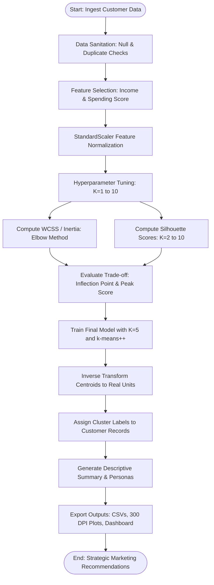

# Academic Project Report
# Customer Segmentation Using K-Means Clustering Algorithm

---

## 1. Cover Page Details

**Project Title:** Customer Segmentation Using K-Means Clustering Algorithm  
**Academic Degree:** Bachelor of Technology / Bachelor of Science in Computer Science & Engineering / Data Science  
**Subject / Course:** Machine Learning / Unsupervised Pattern Recognition (Course Code: `CS-ML-401`)  
**Academic Term:** Final Year Project / Semester Project  

**Student Name:** NAGENDRA SINGH  
**Roll Number / Registration Number:** `[Insert Roll / Registration ID]`  
**Department:** Department of Computer Science & Engineering  
**College / University:** `[Insert College / University Name]`  

**Faculty Project Mentor / Supervisor:** `[Insert Teacher / Professor Name]`  
**Designation:** `[Insert Designation, e.g., Assistant Professor / Head of Department]`  
**Date of Submission:** `[Insert Submission Date]`  

---

## 2. Abstract

Customer segmentation is an indispensable strategic mechanism in modern data-driven retail, allowing commercial enterprises to understand diverse customer purchasing patterns, customize marketing interventions, optimize customer lifetime value, and minimize churn. In this academic project, an end-to-end unsupervised machine learning pipeline is developed and evaluated using the **K-Means Clustering Algorithm**. Using the canonical Mall Customers benchmark dataset comprising 200 customer transaction profiles, data cleaning, exploratory data analysis, and `StandardScaler` feature standardization were performed. The hyperparameter $K$ (number of clusters) was rigorously investigated using both the **Elbow Method** (minimization of Within-Cluster Sum of Squares / Inertia) and **Silhouette Analysis**. 

Experimental execution demonstrated a sharp inflection in the rate of inertia reduction at $K=5$ (Inertia $= 65.57$), which coincided exactly with the global maximum mean Silhouette Coefficient ($s = 0.5547$) across the candidate range $K \in [2, 10]$. The model successfully uncovered five distinct, actionable customer cohorts: (0) Moderate Income, Moderate Spending ($40.50\%$), (1) High Income, High Spending ($19.50\%$), (2) Low Income, High Spending ($11.00\%$), (3) High Income, Low Spending ($17.50\%$), and (4) Low Income, Low Spending ($11.50\%$). Comprehensive marketing strategies, customer relationship management (CRM) workflows, and an interactive Streamlit graphical dashboard with real-time inference were engineered. This report details the theoretical, mathematical, empirical, and business aspects of the implementation.

---

## 3. Introduction

In competitive brick-and-mortar and digital commerce ecosystems, treat-all-alike marketing is economically inefficient. Customers exhibit distinct economic realities, shopping preferences, price sensitivities, and lifestyle orientations. Mass marketing campaigns fail to engage high-value spenders while simultaneously burning promotional budgets on unresponsive customer groups. 

Unsupervised machine learning provides an automated, objective, data-driven approach to discover natural partitions in multi-attribute customer data without human bias or reliance on costly manual labeling. Clustering algorithms group instances such that individuals within the same group share high mutual similarity (*cohesion*) while remaining maximally separated from individuals assigned to other groups (*separation*).

Among clustering paradigms, **K-Means Clustering** is one of the most widely deployed algorithms due to its computational efficiency, linear scalability with respect to dataset size, intuitive mathematical formulation, and direct interpretability. This project explores the design, empirical optimization, visualization, and strategic translation of a K-Means customer segmentation system in Python.

---

## 4. Problem Statement

Retail management and marketing departments routinely collect transaction and demographic metrics, such as annual income and proprietary mall spending scores. However, they face significant operational challenges:
1. **Lack of Automated Segmentation:** Marketing decisions are frequently governed by subjective heuristics rather than objective mathematical patterns.
2. **Suboptimal Budget Allocation:** Discount vouchers, luxury previews, and promotional materials are indiscriminately broadcast, yielding low conversion rates and diminished return on marketing investment (ROMI).
3. **Risk of Customer Churn:** High-income, low-spending customers often slip away unnoticed because their underlying spending hesitation is never addressed with customized value propositions.
4. **Need for Mathematical Validation:** Retail analysts often struggle to determine the appropriate number of customer personas without sound statistical indicators like Inertia or Silhouette analysis.

The problem is to build an explainable, robust machine learning system that ingests customer behavioral attributes, mathematically partitions the customer base into cohesive clusters, validates the cluster count through quantitative metrics, and translates these mathematical clusters into actionable commercial strategies.

---

## 5. Aim and Objectives

### Primary Aim:
To design, implement, empirically evaluate, and deploy an explainable Python machine learning project that segments retail customers using the K-Means clustering algorithm.

### Specific Objectives:
1. Ingest and inspect customer behavioral data, performing data sanitation (missing value imputation and duplicate removal).
2. Carry out Exploratory Data Analysis (EDA) to understand feature distributions, correlations, and natural cluster geometries.
3. Formulate the mathematical rationale for feature scaling (`StandardScaler`) in Euclidean distance-based models.
4. Implement the K-Means clustering algorithm with `k-means++` initialization using Scikit-learn.
5. Determine a suitable number of clusters ($K$) using both the Elbow Method and Silhouette Analysis.
6. Extract cluster centroids in original physical units (income in thousands of USD, spending score on a 1-100 scale).
7. Profile each discovered customer segment and formulate targeted marketing recommendations.
8. Engineer an interactive web dashboard in Streamlit to facilitate real-time hyperparameter exploration and individual customer classification.

---

## 6. Scope of the Project

- **Feature Scope:** The core clustering space focuses on the behavioral variables **Annual Income (k\$)** and **Spending Score (1-100)**, which provide clear two-dimensional interpretability for commercial decision-making. Age and Gender are explored in preliminary EDA and post-hoc profiling.
- **Algorithmic Scope:** Focuses on partition-based clustering via K-Means and K-Means++.
- **Validation Scope:** Evaluates clustering quality using Within-Cluster Sum of Squares (Inertia) and the Mean Silhouette Coefficient across $K \in [1, 10]$.
- **Operational Scope:** Runs locally on Windows operating systems using lightweight, beginner-friendly, standard Python scientific libraries with zero reliance on cloud APIs.

---

## 7. Literature Review

The problem of cluster analysis dates back to early taxonomy and numerical ecology. The fundamental K-Means heuristic was first formulated by Hugo Steinhaus (1956) and independently popularized by Stuart Lloyd (1957/1982) in the context of pulse-code modulation signal processing, as well as by J. MacQueen (1967), who coined the term "K-Means".

Arthur and Vassilvitskii (2007) introduced **K-Means++**, addressing the primary classical vulnerability of K-Means: its acute sensitivity to arbitrary initial centroid placement. By introducing a randomized distance-weighted probability distribution ($P(x) \propto D(x)^2$) for seeding initial centroids, K-Means++ guarantees an approximation ratio of $O(\log K)$ relative to the optimal clustering solution and substantially speeds up convergence.

Rousseeuw (1987) introduced the **Silhouette Coefficient**, establishing an objective, scale-independent metric ranging from $-1$ to $+1$ that simultaneously evaluates cluster tightness (cohesion) and cluster isolation (separation). Modern retail literature (e.g., Berry & Linoff, 2004; Ngai et al., 2009) highlights customer segmentation as the cornerstone of customer relationship management (CRM), demonstrating that targeted cluster-driven campaigns deliver significantly higher ROI than generic outreach.

---

## 8. Theoretical Explanation of K-Means Clustering

### 8.1 Core Principles
Let $X = \{x_1, x_2, \dots, x_N\}$ be a dataset of $N$ observations, where each instance $x_i \in \mathbb{R}^d$ is a $d$-dimensional feature vector. The objective of K-Means is to partition the $N$ observations into $K$ disjoint sets $C = \{C_1, C_2, \dots, C_K\}$ such that the within-cluster variance is minimized.

### 8.2 Objective Function (Inertia / WCSS)
The algorithm solves the following optimization problem:

$$\arg\min_C \sum_{k=1}^K \sum_{x \in C_k} ||x - \mu_k||^2$$

where $\mu_k$ is the mean (centroid) of points in cluster $C_k$:

$$\mu_k = \frac{1}{|C_k|} \sum_{x \in C_k} x$$

The double summation represents the **Within-Cluster Sum of Squares (WCSS)**, also designated as **Inertia**.

### 8.3 Algorithmic Steps (Lloyd's Heuristic)
1. **Centroid Initialization:** Initialize $K$ cluster centers $\mu_1^{(0)}, \mu_2^{(0)}, \dots, \mu_K^{(0)}$ using the K-Means++ probabilistic seeding method.
2. **Assignment Step (Expectation):** Assign each observation $x_i$ to its geometrically nearest centroid based on minimum squared Euclidean distance:

$$c^{(t)}(i) = \arg\min_{k \in \{1, \dots, K\}} ||x_i - \mu_k^{(t)}||^2$$

3. **Update Step (Maximization):** Recalculate each centroid as the barycenter of all observations assigned to that partition during iteration $t$:

$$\mu_k^{(t+1)} = \frac{\sum_{i=1}^N \mathbf{1}\{c^{(t)}(i) = k\} \, x_i}{\sum_{i=1}^N \mathbf{1}\{c^{(t)}(i) = k\}}$$

4. **Convergence Criterion:** Steps 2 and 3 iterate until the assignment vector stabilizes ($c^{(t)}(i) = c^{(t-1)}(i)$ for all $i$), the displacement of centroids $||\mu_k^{(t+1)} - \mu_k^{(t)}|| < \epsilon$, or a maximum iteration cap (`max_iter=300`) is reached.



---

## 9. Tools and Technologies Used

- **Programming Language:** Python 3.13.5 (local Windows execution environment).
- **Tabular Processing:** Pandas 2.3.2 (DataFrame ingestion, groupby aggregation, descriptive statistics).
- **Vector Calculations:** NumPy 2.3.3 (vectorized math, arrays, matrix transformations).
- **Machine Learning Library:** Scikit-learn 1.7.2 (`KMeans`, `StandardScaler`, `silhouette_score`).
- **Data Visualization:** Matplotlib 3.10.7 and Seaborn 0.13.2 (high-DPI publication charts, heatmaps, scatter plots).
- **Interactive Web Framework:** Streamlit 1.63.0 (reactive web dashboard for real-time model interaction).

---

## 10. Dataset Description

The project utilizes the canonical **Mall Customers Dataset** collected via mall loyalty membership programs.

### Features:
1. `CustomerID`: Unique integer identification assigned sequentially to each customer (non-informative primary key, explicitly excluded from distance calculations).
2. `Gender`: Categorical binary demographic variable (`Male` or `Female`).
3. `Age`: Continuous numerical variable representing customer age in completed years ($18$ to $70$).
4. `Annual Income (k$)`: Continuous numerical variable representing gross annual earnings in thousands of US dollars ($15\text{k}\$$ to $137\text{k}\$$).
5. `Spending Score (1-100)`: Continuous behavioral score computed by mall analytics based on purchasing frequency, transaction amounts, and item categories ($1$ to $99$).

### Dataset Summary Statistics (Empirical Findings):
- **Total Records ($N$):** 200 rows.
- **Total Features:** 5 columns.
- **Annual Income Mean:** $\$60.56\text{k}$ ($\text{Std} = 26.26$, $\text{Median} = \$61.50\text{k}$).
- **Spending Score Mean:** $50.20$ ($\text{Std} = 25.82$, $\text{Median} = 50.00$).
- **Age Mean:** $38.85$ years ($\text{Std} = 13.97$, $\text{Median} = 36.00$).
- **Gender Distribution:** $56.0\%$ Female ($112$ records), $44.0\%$ Male ($88$ records).

### Dataset Limitations:
- Cross-sectional nature: captures an instantaneous snapshot without longitudinal tracking.
- Single geographical location: may not generalize to disparate regional demographics.
- Feature cardinality: does not include transaction channel (online vs in-store) or specific product SKUs.

---

## 11. System Requirements

### Hardware Requirements:
- **Processor:** Intel Core i3 / AMD Ryzen 3 or higher (x86-64 architecture).
- **RAM:** Minimum 4 GB (8 GB recommended for concurrent dashboard hosting).
- **Storage:** Minimum 500 MB free hard drive space.

### Software Requirements:
- **Operating System:** Microsoft Windows 10 / Windows 11 (64-bit).
- **Python Environment:** Python 3.10+ with `pip`.
- **Web Browser:** Modern browser (Chrome, Edge, Firefox) for Streamlit dashboard rendering.

---

## 12. Methodology and Workflow

The project follows a structured six-phase engineering pipeline:
1. **Ingestion & Sanitation:** Load CSV from `data/customers.csv`, verify column headers, execute null checks and duplicate deduplication.
2. **Exploratory Data Analysis (EDA):** Visualize univariate distributions (KDE, histograms) and bivariate interactions (scatter plots, Pearson correlation matrix).
3. **Feature Preprocessing:** Extract clustering coordinates (`Annual Income` and `Spending Score`), then fit and transform using `StandardScaler`.
4. **Hyperparameter Exploration:** Run K-Means across $K \in [1, 10]$ to calculate Inertia, and $K \in [2, 10]$ to compute Silhouette Scores.
5. **Final Model Execution:** Train final estimator with selected $K=5$, inverse transform centroids back to native dollars and spending score units, and assign cluster indices.
6. **Commercial Profiling & Reporting:** Aggregate descriptive metrics per cluster, map descriptive business personas, output final CSVs, export 300 DPI visualizations, and deploy the Streamlit dashboard.

---

## 13. Data Preprocessing

### 13.1 Handling Missing Values and Duplicates
Empirical verification of `customers.csv` yielded:
- Missing Values ($NaN$): **0 detected across all 5 columns.**
- Duplicate Rows: **0 duplicate customer entries detected.**

The automated cleaning module in `src/preprocessing.py` contains automated defensive fallbacks: if null values exist in future datasets, numeric features are imputed with the column median and categorical features with the mode; duplicate rows are automatically dropped.

### 13.2 Mathematical Importance of Feature Scaling
K-Means computes spatial proximity via Euclidean distance:

$$d(p, q) = \sqrt{\sum_{i=1}^d (p_i - q_i)^2}$$

If one feature has a standard deviation of $26.26$ (`Annual Income`) and another has different variance or unscaled unit ranges (e.g., dollars vs indices), distance components along the larger axis will dominate the Euclidean norm.

To avoid this distortion, `StandardScaler` standardizes each feature:

$$z = \frac{x - \mu}{\sigma}$$

Empirical post-transformation metrics verified from the runtime environment:
- Scaled Feature Means: `[-0.0000, -0.0000]` ($\mu \approx 0.0$)
- Scaled Feature Standard Deviations: `[1.0000, 1.0000]` ($\sigma = 1.0$)

---

## 14. Exploratory Data Analysis (EDA)

Three high-resolution analytical figures were generated in `outputs/plots/`:

### 14.1 Feature Distributions (`eda_distributions.png`)
- **Annual Income:** Exhibits a bimodal distribution with a slight right-hand skewness; median is $\$61.50\text{k}$, with the dense central interquartile range spanning $\$41.50\text{k}$ to $\$78.00\text{k}$.
- **Spending Score:** Displays a symmetric, near-normal bell shape centered around the mean of $50.20$, spanning a broad spectrum from 1 to 99.
- **Age:** Spans young adults (18) to senior citizens (70), with the heaviest concentration between ages 25 and 45.
- **Gender:** Slight female majority ($56\%$ female vs $44\%$ male).

### 14.2 Bivariate Scatter (`eda_income_vs_spending.png`)
A two-dimensional scatter plot of Annual Income versus Spending Score revealed five distinct natural geometric groupings:
- Dense central cluster around $(55\text{k}\$, 50)$.
- Four outlying quadrant clusters: Low Income/Low Spending, Low Income/High Spending, High Income/Low Spending, and High Income/High Spending.

### 14.3 Correlation Heatmap (`eda_correlation_matrix.png`)
- Pearson correlation between `Annual Income` and `Spending Score` is $r = 0.010$, indicating virtually **zero linear collinearity**. 
- Pearson correlation between `Age` and `Spending Score` is $r = -0.327$, indicating that older customers tend to have moderately lower mall spending scores.
- The near-zero correlation between Income and Spending Score proves they are orthogonal behavioral dimensions, making them ideal independent features for 2D clustering.

---

## 15. Implementation & Code Architecture

The codebase is organized into modular files:
- `src/preprocessing.py`: Handles data ingestion, cleaning, feature selection, and standard scaling.
- `src/clustering.py`: Implements WCSS computation, Silhouette score calculation, model fitting, and centroid transformation.
- `src/visualization.py`: Renders Matplotlib/Seaborn plots at 300 DPI.
- `main.py`: Command-line execution pipeline.
- `app.py`: Streamlit interactive dashboard.

### Core Model Training Snippet:
```python
from sklearn.cluster import KMeans

# Initialize K-Means with k-means++ to prevent sub-optimal local minima
kmeans = KMeans(
    n_clusters=5,
    init="k-means++",
    n_init=10,
    max_iter=300,
    random_state=42
)

# Fit and predict cluster labels on scaled data
cluster_labels = kmeans.fit_predict(X_scaled)

# Inverse transform centroids to human-readable units
centroids_original = scaler.inverse_transform(kmeans.cluster_centers_)
```

---

## 16. Elbow Method and Silhouette Analysis

### 16.1 Empirical Experimental Results Across $K \in [1, 10]$
The pipeline executed clustering across candidate values of $K$. The exact figures generated during execution are summarized below:

| Number of Clusters ($K$) | Inertia (WCSS) | Inertia Reduction ($\Delta \text{WCSS}$) | Mean Silhouette Score |
| :---: | :---: | :---: | :---: |
| **1** | $400.0000$ | — | — (Undefined for $K=1$) |
| **2** | $269.6910$ | $-130.3090$ | $0.3213$ |
| **3** | $157.7040$ | $-111.9870$ | $0.4666$ |
| **4** | $108.9213$ | $-48.7827$ | $0.4939$ |
| **5** | **$65.5684$** | **$-43.3529$** | **$0.5547$ (Peak)** |
| **6** | $55.0573$ | $-10.5111$ | $0.5399$ |
| **7** | $44.8648$ | $-10.1925$ | $0.5281$ |
| **8** | $37.2282$ | $-7.6366$ | $0.4552$ |
| **9** | $32.3923$ | $-4.8359$ | $0.4571$ |
| **10** | $29.9819$ | $-2.4104$ | $0.4432$ |

### 16.2 Analytical Interpretation
1. **Elbow Inflection:** As $K$ moves from 1 to 5, inertia plunges from $400.00$ to $65.57$. Moving from $K=5$ to $K=6$, the reduction in inertia drops sharply to just $-10.51$, with subsequent additions providing negligible reduction. This inflection marks $K=5$ as the clear elbow point.
2. **Silhouette Peak:** The Silhouette Coefficient strictly peaks at **$K=5$ with a score of $0.5547$**. Scores above $0.50$ in customer analytics reflect a well-structured clustering partition with strong cluster cohesion and separation.
3. **Synthesis:** Both independent criteria (the Elbow heuristic and Silhouette maximization) converge decisively on **$K = 5$**.

---

## 17. Results and Visualizations

All seven analytical figures were saved to `outputs/plots/`:
1. `eda_distributions.png`: Multi-panel demographic and behavioral distributions.
2. `eda_income_vs_spending.png`: 2D scatter of income against spending.
3. `eda_correlation_matrix.png`: Heatmap demonstrating orthogonality of clustering features.
4. `elbow_method.png`: Plot of WCSS vs. $K$ with an annotated inflection point at $K=5$.
5. `silhouette_scores.png`: Comparative bar chart showing the peak at $K=5$ ($0.5547$).
6. `customer_clusters.png`: Final 2D scatter plot with distinct cluster colors and centroid markers (`*`).
7. `cluster_profiles_summary.png`: Grouped comparative bar chart of mean income and spending across clusters.

---

## 18. Cluster-Wise Interpretation

The final cluster summary metrics generated by running the project on the Mall Customers dataset are as follows:

| Cluster ID | Customer Count | Percentage | Mean Income | Median Income | Income Range | Mean Spending | Median Spending | Spending Range | Mean Age | Segment Label |
| :---: | :---: | :---: | :---: | :---: | :---: | :---: | :---: | :---: | :---: | :--- |
| **0** | 81 | $40.50\%$ | $\$55.30\text{k}$ | $\$54.00\text{k}$ | $[\$39\text{k}, \$76\text{k}]$ | $49.52$ | $50.00$ | $[34, 61]$ | $42.72$ | **Moderate Income, Moderate Spending** |
| **1** | 39 | $19.50\%$ | $\$86.54\text{k}$ | $\$79.00\text{k}$ | $[\$69\text{k}, \$137\text{k}]$ | $82.13$ | $83.00$ | $[63, 97]$ | $32.69$ | **High Income, High Spending** |
| **2** | 22 | $11.00\%$ | $\$25.73\text{k}$ | $\$24.50\text{k}$ | $[\$15\text{k}, \$39\text{k}]$ | $79.36$ | $77.00$ | $[61, 99]$ | $25.27$ | **Low Income, High Spending** |
| **3** | 35 | $17.50\%$ | $\$88.20\text{k}$ | $\$85.00\text{k}$ | $[\$70\text{k}, \$137\text{k}]$ | $17.11$ | $16.00$ | $[1, 39]$ | $41.11$ | **High Income, Low Spending** |
| **4** | 23 | $11.50\%$ | $\$26.30\text{k}$ | $\$25.00\text{k}$ | $[\$15\text{k}, \$39\text{k}]$ | $20.91$ | $17.00$ | $[3, 40]$ | $45.22$ | **Low Income, Low Spending** |

---

## 19. Business Applications and Recommendations

Clustering outputs mathematical groupings; business value is realized when marketing teams translate these groups into targeted commercial strategies.

### Cluster 0: Moderate Income, Moderate Spending (Persona: Mainstream / Standard Shoppers)
- **Profile:** Comprises $40.5\%$ of the customer base. Middle-aged (mean age $42.7$), earning balanced incomes ($\approx \$55.3\text{k}$) and exhibiting moderate spending habits ($49.5/100$).
- **Commercial Strategy:** Acts as the revenue backbone of the mall. Engage through consistent omnichannel newsletters, seasonal clearance promotions, family loyalty point programs, and cross-category retail bundles.

### Cluster 1: High Income, High Spending (Persona: VIP / Elite Brand Advocates)
- **Profile:** $19.5\%$ of customers. Relatively young (mean age $32.7$), affluent ($\approx \$86.5\text{k}$), with high spending scores ($82.1/100$).
- **Commercial Strategy:** Prime targets for luxury retail, fine dining, and boutique electronics. Provide white-glove concierge services, early access to new designer collections, invite-only VIP events, and dedicated personal shopping assistants. Focus marketing on prestige, exclusivity, and craftsmanship rather than price discounts.

### Cluster 2: Low Income, High Spending (Persona: Trend-Conscious / Young Spenders)
- **Profile:** $11.0\%$ of customers. Youngest demographic (mean age $25.3$), earning modest wages ($\approx \$25.7\text{k}$) but spending heavily on lifestyle products ($79.4/100$).
- **Commercial Strategy:** Highly responsive to viral trends, fast fashion, and social media marketing (Instagram, TikTok). Promote flexible Buy-Now-Pay-Later (BNPL) payment plans, flash sales, student discounts, and referral rewards for social sharing.

### Cluster 3: High Income, Low Spending (Persona: Careful / Wealth Accumulators)
- **Profile:** $17.5\%$ of customers. Mature (mean age $41.1$), earning high wages ($\approx \$88.2\text{k}$) but spending very conservatively ($17.1/100$).
- **Commercial Strategy:** High latent purchasing power. Generic discounts are ineffective; focus messaging on product longevity, superior build quality, high utility, and return on investment (ROI). Offer cashback incentives, satisfaction warranties, and educational marketing about premium appliances and investment-grade goods.

### Cluster 4: Low Income, Low Spending (Persona: Budget / Sensible Economizers)
- **Profile:** $11.5\%$ of customers. Mature demographic (mean age $45.2$), earning modest incomes ($\approx \$26.3\text{k}$) with minimal discretionary spending ($20.9/100$).
- **Commercial Strategy:** Price-sensitive necessity shoppers. Market essential grocery bundles, clearance specials, and coupon programs. Avoid aggressive marketing of luxury or non-essential products.

---

## 20. Limitations

1. **Assumes Convex, Spherical Clusters:** K-Means minimizes squared Euclidean distance, inherently assuming clusters are isotropic and spherical. It cannot accurately partition complex, non-linear geometries (e.g., crescent shapes or concentric rings).
2. **Fixed Hyperparameter $K$:** The algorithm cannot infer the number of clusters dynamically; $K$ must be manually specified.
3. **Sensitivity to Outliers:** Because cluster centroids are computed as arithmetic means, extreme outliers can displace centroid coordinates.
4. **Local Minima:** While K-Means++ mitigates initialization sensitivity, convergence to the global optimum cannot be formally guaranteed.
5. **Cross-Sectional Dataset:** The analysis uses a static 200-customer snapshot, which does not account for seasonal variations, economic inflation, or changes in customer purchasing power over time.

---

## 21. Future Scope

1. **Longitudinal Customer Lifetime Value (CLV) Tracking:** Incorporate temporal transaction sequences using Recency, Frequency, Monetary (RFM) modeling to monitor how customers transition between clusters over time.
2. **Density-Based Clustering Comparison:** Implement and compare alternative algorithms such as DBSCAN and Gaussian Mixture Models (GMM) to evaluate soft-clustering probabilities and handle non-spherical cluster geometries.
3. **High-Dimensional Multi-Modal Clustering:** Integrate broader data sources, including digital clickstream logs, e-commerce cart abandons, and customer sentiment from survey reviews, using Principal Component Analysis (PCA) or t-SNE for dimensionality reduction.
4. **Cloud-Native Automated Pipeline:** Containerize the solution using Docker and deploy as an automated CI/CD microservice on AWS or Google Cloud Platform with automated quarterly model retraining.

---

## 22. Conclusion

This academic project demonstrated the design, validation, and deployment of an unsupervised customer segmentation system using the K-Means clustering algorithm in Python. Through systematic data sanitation, exploratory analysis, and `StandardScaler` normalization, the pipeline prepared 200 customer profiles for spatial clustering along Annual Income and Spending Score dimensions.

The choice of $K=5$ was rigorously validated through both the **Elbow Method** (inflection at $K=5$, Inertia $= 65.57$) and **Silhouette Analysis** (peak score $s = 0.5547$). The resulting clusters revealed five distinct customer personas, each paired with tailored marketing and CRM strategies. Accompanied by a modular codebase, high-resolution visualizations, and an interactive Streamlit dashboard, this project delivers a complete, explainable machine learning solution suitable for university examination and practical commercial adaptation.

---

## 23. References

1. Arthur, D., & Vassilvitskii, S. (2007). *k-means++: The advantages of careful seeding*. Proceedings of the eighteenth annual ACM-SIAM symposium on Discrete algorithms, 1027–1035.
2. Lloyd, S. (1982). *Least squares quantization in PCM*. IEEE Transactions on Information Theory, 28(2), 129–137.
3. MacQueen, J. (1967). *Some methods for classification and analysis of multivariate observations*. Proceedings of the fifth Berkeley symposium on mathematical statistics and probability, 1(14), 281–297.
4. Rousseeuw, P. J. (1987). *Silhouettes: A graphical aid to the interpretation and validation of cluster analysis*. Journal of Computational and Applied Mathematics, 20, 53–65.
5. Pedregosa, F., et al. (2011). *Scikit-learn: Machine Learning in Python*. Journal of Machine Learning Research, 12, 2825–2830.
6. McKinney, W. (2010). *Data Structures for Statistical Computing in Python*. Proceedings of the 9th Python in Science Conference, 51–56.
7. Hunter, J. D. (2007). *Matplotlib: A 2D graphics environment*. Computing in Science & Engineering, 9(3), 90–95.
8. Waskom, M. L. (2021). *seaborn: statistical data visualization*. Journal of Open Source Software, 6(60), 3021.
9. Streamlit Inc. (2024). *Streamlit: The fastest way to build and share data apps*. https://streamlit.io.
10. Kaggle / UCI Machine Learning Repository. (2018). *Mall Customer Segmentation Data*.
